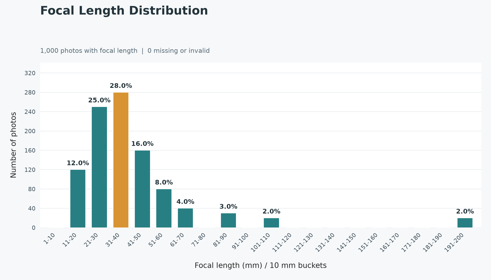
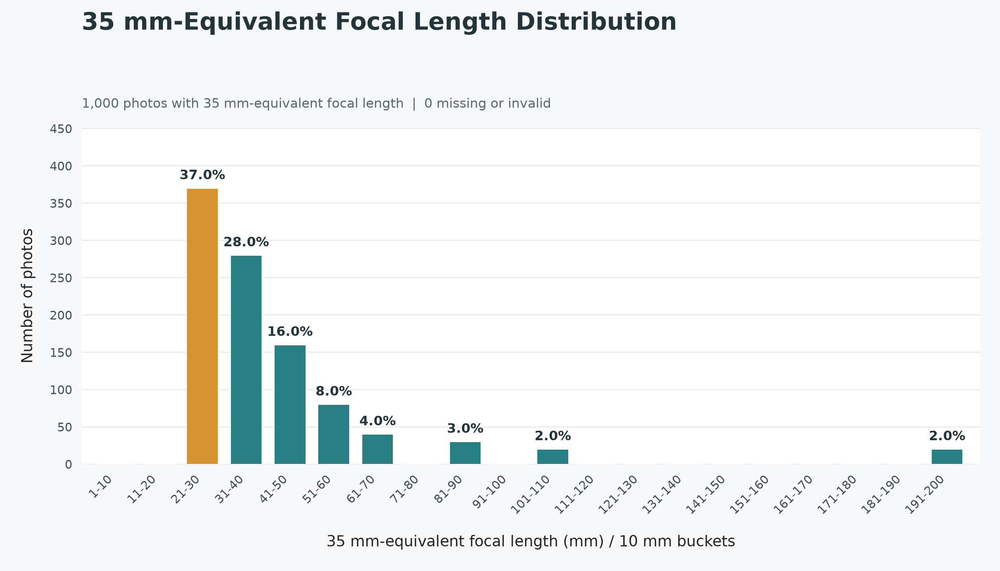
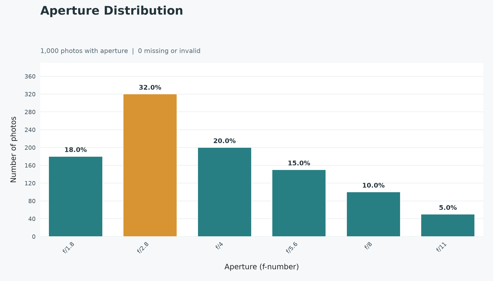
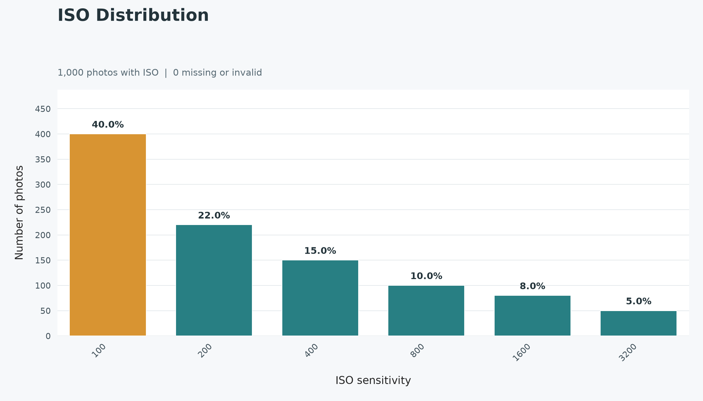
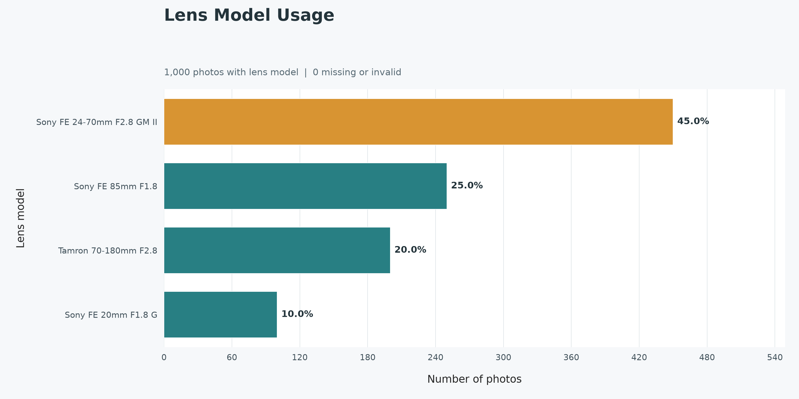
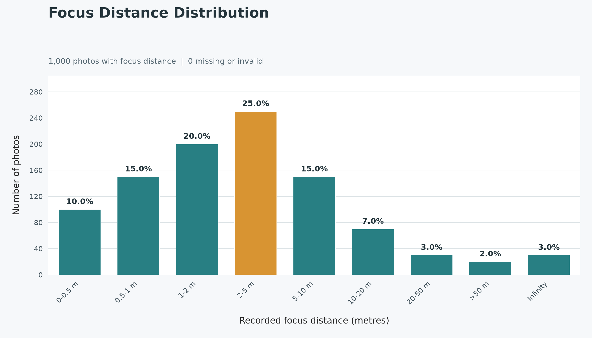

# Photo EXIF Export and Usage Charts

Two command-line Python tools for understanding your photography habits. Scan a
folder of photos to export EXIF metadata, including camera, lens, focal length,
exposure settings, and capture dates, into a CSV with one row per photo. Then
turn that CSV into charts of focal lengths, apertures, ISO settings, lens models,
focus distances, and 35 mm-equivalent focal lengths to understand how you shoot.

Extraction supports subfolders, displays progress, and resumes from CSV
checkpoints saved every 100 photos. Charting runs independently, so you can
regenerate reports without rescanning your images. Source photos are never edited.

## Supported Formats

The extractor scans the following extensions (case-insensitive). Metadata
availability depends on the file and what its camera or editing software saved.

| Format | Extensions |
| --- | --- |
| Sony RAW | `.arw`, `.srf`, `.sr2` |
| Adobe Digital Negative | `.dng` |
| Canon RAW | `.cr2`, `.cr3` |
| Nikon RAW | `.nef`, `.nrw` |
| Fujifilm RAW | `.raf` |
| Olympus RAW | `.orf` |
| Panasonic RAW | `.rw2` |
| Pentax RAW | `.pef` |
| JPEG | `.jpg`, `.jpeg` |
| TIFF | `.tif`, `.tiff` |
| Other images | `.png`, `.heic`, `.heif`, `.avif`, `.webp` |

Outputs are a UTF-8 CSV metadata report and six PNG charts.

## Example Output

These examples use **1,000 synthetic photos**, not real photo metadata. Each
nonzero bucket shows its share of photos with valid metadata for that chart;
the most-used bucket is highlighted in amber.

### Focal Length

Actual lens focal lengths grouped into 10 mm buckets.



### Full-Frame Equivalent Focal Length

The same synthetic focal lengths expressed as 35 mm equivalents, using explicit
crop factors of 1.0 and 1.5 for the dummy cameras.



### Aperture

Recorded f-numbers show how frequently wide versus stopped-down apertures are used.



### ISO

Recorded ISO settings show the balance between low and high sensitivity.



### Lens Model

Horizontal bars rank the synthetic lens models by photo count.



### Focus Distance

Recorded subject distances are grouped into metre ranges, with a separate
infinity category. Real photos may not contain this metadata.



## Setup and Usage

Requires Python 3.10+. Extraction uses [ExifTool](https://exiftool.org/), which
supports Sony ARW and many other RAW formats without decoding the image pixels.
Analytics uses Seaborn and Matplotlib and reads only the exported CSV; it does not require
ExifTool or access to the original photos.

On Windows, download and extract the ExifTool Windows package, keep its supporting
files together, and rename `exiftool(-k).exe` to `exiftool.exe`. Add its directory
to PATH or supply its full path with `--exiftool`.

Install the Python dependencies (`tqdm` for extraction progress, Seaborn and Matplotlib
for analytics; extraction also requires the external ExifTool executable):

```powershell
python -m pip install -r requirements.txt
```

Run the two stages independently from your desired output directory:

```powershell
python photo_exif.py "D:\Photos" --recursive
python photo_analytics.py
```

Extraction displays a live progress bar with photo count, percentage, processing
speed, and estimated time remaining. The bar uses stderr and is automatically
hidden when stderr is redirected or is not an interactive terminal. ExifTool
warnings and errors remain visible. No extra command-line option is required.

Extraction checkpoints every 100 photos (and the final smaller batch). Each
completed batch atomically replaces the CSV with all completed rows. The CSV
itself is the only resume checkpoint; no database or sidecar is needed. Two
columns, `Resume:FileSize` and `Resume:FileMTimeNS`, store source file size in
bytes and modification time in nanoseconds. Keep these columns intact.

Rerun the same command with the same CSV path to resume automatically. Successful
photos with the same absolute path, file size, and nanosecond modification time
are skipped; new, changed, and previously failed photos are processed. Rows are
unique per photo path. Photos no longer in the current scan are omitted from the
CSV. Progress starts at the number of already cached photos.

Ctrl+C or a crash loses at most the current uncommitted batch, not earlier
checkpoints. If CSV export fails (for example, the CSV is open in Excel), close
the file and rerun: rows in the last successful CSV are reused and the unsaved
batch is processed again. Keep the CSV after completion for idempotent reruns,
and do not run two extractors against the same CSV simultaneously. Delete or
rename the CSV to force a full rescan. Legacy CSV rows without the resume columns
are reprocessed once because source changes cannot be verified. Old SQLite
sidecars are ignored and can be removed; existing sidecars are not deleted
automatically. Malformed checkpoint CSVs are rejected instead of overwritten.

With explicit executable and output locations:

```powershell
python photo_exif.py "D:\Photos" --exiftool "C:\Tools\exiftool.exe" --csv "D:\Reports\photos.csv"
python photo_analytics.py "D:\Reports\photos.csv" --chart "D:\Reports\focal_lengths.png"
```

To place all charts in a custom directory:

```powershell
python photo_analytics.py "D:\Reports\photos.csv" --output-dir "D:\Reports\charts"
```

`photo_exif.py` only creates `photo_metadata.csv`. `photo_analytics.py` reads
`photo_metadata.csv` by default and creates these charts in `./output/`:

| File | Contents |
| --- | --- |
| `focal_lengths.png` | Actual lens focal length in 10 mm buckets |
| `focal_lengths_35mm.png` | Full-frame (35 mm-equivalent) focal length in 10 mm buckets |
| `apertures.png` | Recorded f-numbers, rounded to one decimal place |
| `iso.png` | Recorded ISO sensitivity values |
| `lens_models.png` | Lens usage, ranked by number of photos |
| `focus_distances.png` | Recorded focus distance in metre ranges, plus infinity |

The default `output/` directory is ignored by Git. `--output-dir` changes the
directory for all charts; the existing `--chart` option overrides only the actual
focal-length chart's path. The metadata CSV still defaults to the current working
directory. Neither output location depends on the photo folder, input CSV
directory, or script directory. Relative paths resolve from the current working
directory. You can rerun analytics without extracting metadata again.
When running from another directory, use the full path to each Python script.

Subfolders are scanned only with `--recursive`. Source photos are not modified.
Output paths must end in `.csv` and `.png`, respectively. Existing output reports
are replaced atomically after each extraction batch (charts are replaced by
analytics). Extraction excludes the default `output/` directory and the legacy
`./focal_lengths.png` chart. Custom charts inside the photo tree are treated
as images; keep custom reports outside the scanned photo tree. Reserve the chart
output filename for reports; do not point it at an existing photo you want to keep.

The CSV contains one row per discovered photo and the union of all metadata tags
returned by ExifTool, including camera, lens, exposure, dates, and GPS if present.
Group-prefixed column names distinguish metadata locations. Numeric EXIF values
are exported without display units; structured values are JSON within a cell.
The CSV uses UTF-8 with a BOM for Excel compatibility. Treat it as sensitive if
photos contain location or identifying metadata.

Charts use a Seaborn white-grid style, larger labels, and highlight the most-used
bucket(s) in amber. Nonzero buckets show their percentage of photos with valid
metadata for that chart, excluding missing/invalid values. Each chart reports its
own missing-data count and is still generated when no usable data is present.
Lens models use horizontal bars with wrapped labels. Figures widen for larger
numeric ranges.

The chart counts actual lens focal length, not the 35 mm equivalent. Buckets are
1-10, 11-20, 21-30 mm, etc., including zero-count buckets between focal lengths.
For fractional focal lengths, intervals are (0, 10], (10, 20], (20, 30], etc.;
for example, 20.1 mm is counted in the bucket labeled 21-30. Missing, zero, or
invalid focal lengths stay in the CSV but are excluded from counts and reported
in the chart title. An empty-data chart is still produced when none are valid.
Extraction errors are retained in CSV error columns where possible.

The separate 35 mm-equivalent chart uses recorded `FocalLengthIn35mmFormat` or
`FocalLength35efl`, falling back to actual focal length multiplied by an explicit
`ScaleFactor35efl`. It never guesses crop factors from camera model names or
assumes actual focal length is full-frame equivalent.

Aperture uses `FNumber` or the composite `Aperture`; ISO uses recorded sensitivity.
Lens names prefer `LensModel`, then textual `LensID` or `Lens`; numeric lens IDs
are excluded because they are not model names. Focus distance uses
`SubjectDistance`, `FocusDistance`, or Sony `FocusDistance2` in metres. Bins are
(0, 0.5], (0.5, 1], (1, 2], (2, 5], (5, 10], (10, 20], (20, 50], >50 m, and
infinity. Zero and unknown distances are excluded. Distance metadata is often
absent or approximate, particularly in RAW files; the chart reflects reported
values rather than measured subject distances. Older CSVs need no format change,
but missing tags cannot be recovered without re-extraction.

Tests:

```powershell
python -m unittest -v
```
